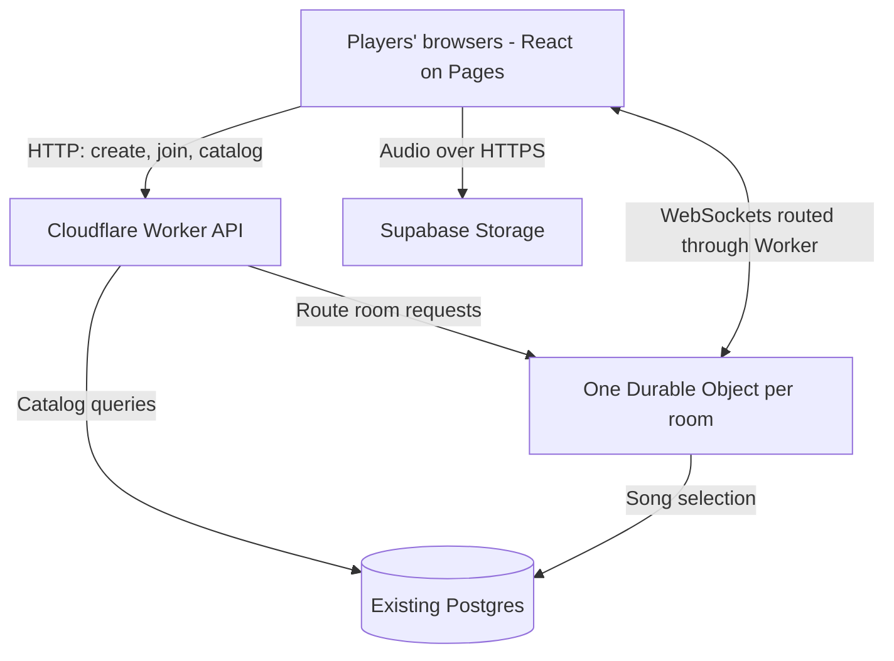

# Animasters multiplayer architecture

Date: October 21, 2026
Status: Architecture and core gameplay accepted; remaining implementation choices and proposed technology updates are identified below.
Scope: The `animasters` frontend and `match-generator` backend.

## Product direction

Animasters will become a browser-based multiplayer anime-song guessing game. Players join a shared room from their own devices, listen to the same song on their own devices, select an anime through autocomplete, and submit a final guess or pass. The backend validates answers, awards points according to the order of correct guesses, reveals round results, and coordinates progression through the match.

The room creator is the host: they choose settings and start the match. Hosting does not require their browser to run the game server. The backend owns the game and can continue if the host disconnects.

Terminology for the new game:

- **Room:** The shared space containing players, settings, and a game session.
- **Match:** A sequence of song rounds ending with final standings.
- **Round:** One song, a guessing period, and its results.
- **Ready:** A player's explicit confirmation that they can start or continue. This is distinct from finishing a guess and from the browser reporting that audio has loaded.

## Accepted decisions

| Area | Decision | Reason |
| --- | --- | --- |
| Client | Keep the React webapp on Cloudflare Pages. | Players can join through a browser without installing anything. |
| API | Keep and extend the Cloudflare Workers backend in `match-generator`. | Reuse the existing API and song-selection logic. |
| Multiplayer | Use one Cloudflare Durable Object per room, with WebSocket connections from players. | Give each room one authority for shared state and game rules. |
| Host | A player creates and manages the room; the server runs it. | The match does not depend on the host's browser staying open. |
| Catalog database | Keep the existing Postgres database described as deployed through Vercel. | Preserve song metadata and support catalog search and saved results. |
| Audio storage | Use Supabase Storage. | Firebase has already been replaced; the owner reports Supabase playback is working. |
| Playback | Every player listens on their own device. | Support remote participation with synchronized round timing. |
| Answers | Autocomplete resolves titles and aliases to a canonical anime ID. | Accommodate alternate names without ambiguous string-based scoring. |
| Scoring | Correct guesses earn N, N − 1, and so on in server acceptance order; incorrect guesses earn −1; passes earn 0. | Reward earlier correct guesses. This replaces the original elapsed-time scoring proposal. |
| Timing | Maximum 90 seconds of guessing; the first submitted guess starts a 20-second window capped by that maximum. | Allow recognition time while bounding each round. A pass does not start this window. |
| Reveal | Reveal when everyone has guessed or passed, or the deadline expires. | Keep the answer private while anyone can still submit. |
| Roster | Initially at most 10 players; no new players after the match starts. | Bound initial scope. Existing players may reconnect throughout the match. |
| Host departure | No host transfer in the first iteration. | Started matches advance automatically; the original host retains their identity on reconnect. |
| Disconnects | Preserve the player's slot and score for the whole match; skip them for readiness and award 0 for unanswered rounds. | Continue play without excluding a returning player permanently. |
| Ties | Allow shared final positions in the first iteration. | A first-correct-guess flash tiebreaker is deferred. |
| Statistics | Defer retained per-player scores and song counts to the second iteration. | Keep the first version focused on playing and completing matches. |
| Recovery | Persist room state and support player reconnection. | Refreshes, brief disconnects, and object restarts should not erase the match. |
| Information disclosure | Keep selected answers and future rounds on the server until permitted. | Avoid exposing the entire answer sheet through the browser's network responses. |

The Supabase change concerns audio storage. It does not imply a migration of the existing Postgres database, adoption of Supabase Auth, or use of Supabase Realtime for room coordination.

## System responsibilities



### Frontend

The frontend renders the lobby, audio player, guess input, countdown, round results, and final standings. Zustand can continue to hold the server's latest room snapshot and local UI state.

Clients send intentions, such as starting a match, submitting an anime ID, or becoming ready. They do not authoritatively advance rounds, judge answers, or modify scores. Volume and local audio controls remain device-specific; local playback problems do not change the server's clock.

### Worker API

The Worker handles entry points for room creation, joining, catalog delivery or search, and WebSocket upgrades routed to the correct room. It validates inputs and room access. Backend credentials remain on the server.

The existing song-generation code becomes an internal service used when preparing a match. Multiplayer clients no longer call an endpoint that returns the complete selected song list and answers.

### Room Durable Object

Each room owns its roster, host identity, settings, selected songs, current phase, deadlines, submissions, readiness, and scores. All authoritative changes pass through that object.

Persist the state needed to recover a match in the object's storage, including deadlines and accepted submissions. In-memory state alone is insufficient because hibernation resets it. Use the WebSocket hibernation API so idle periods do not require the object to remain active in memory.

Use alarms for scheduled phase transitions, with handlers safe to retry. Always check stored deadlines when processing incoming actions: a delayed alarm must not permit a late guess. Browsers render their countdowns locally from server timestamps; the server does not need to broadcast a tick every second.

### Postgres

Postgres owns the persistent anime catalog, aliases, and song metadata. It does not coordinate every live gameplay event. Retained match statistics are deferred to the second iteration; the first iteration still persists active room state and displays final standings from that state.

Future statistics should include each player's final score and number of songs played. Before implementation, define stable identity across matches and what counts as a played song, especially during disconnects. Nicknames alone cannot identify a person reliably. Future result writes should be retryable without duplicates and should not block showing final standings.

### Supabase Storage

Supabase serves audio over HTTPS directly to players. WebSockets carry game messages, not audio bytes. Store a media reference on each song and resolve it into a playable URL on the backend, keeping storage-specific URL construction out of game UI components.

The current frontend uses Supabase public asset URLs; this is a source-code observation, not an inspection of bucket settings. Whether to retain public delivery or adopt private delivery remains an implementation choice. Supabase supports time-limited signed URLs for private assets. If private delivery is chosen, the backend issues URLs only after checking room access, with enough validity for loading, playback, and expected retries. Signing credentials must never enter frontend bundles.

Use opaque object names and remove embedded titles or artwork that reveal answers. A signed URL still exposes its object path, so signing a descriptive filename does not hide the answer. Audio already delivered to a browser can be inspected or replayed; this design prevents easy metadata leakage, not all cheating.

## Room and round lifecycle

```text
Lobby -> Load audio + Ready -> Scheduled start -> Guessing (maximum 90s)
                                                     |
                        First guess -> Remaining time capped at 20s
                                                     |
                     All finished or deadline -> Reveal + round results
                                                     |
                   Next round: Load audio + Ready / Final standings
```

1. The host creates a room and chooses match settings.
2. Players join through a shareable link or short room code and choose nicknames.
3. The backend assigns each player an identity and a private reconnect token. A nickname or room code is not proof of ownership of an existing player.
4. The host starts the match. The server fixes the roster, selects and retains the song sequence, and refuses new joins. Authenticated reconnections are not new joins.
5. The server distributes the current round's permitted media information. Each connected player loads audio and explicitly clicks Ready. Disconnected players do not block readiness.
6. Once the connected participants are ready and their audio is prepared, the server publishes a near-future shared start time. Guessing opens at that time, with no minimum listening period. The initial deadline is 90 seconds after the start.
7. A player submits one final guess or passes. An accepted submission cannot be edited or replaced. The server checks identity, round, phase, and deadline; malformed or unauthorized requests are rejected rather than counted as wrong guesses.
8. The first accepted guess, whether correct or incorrect, sets the deadline to the earlier of the original 90-second deadline and 20 seconds after its acceptance. Later guesses do not restart the timer. Passing does not start it.
9. Guessing ends when all players have submitted or passed, or time expires. Unanswered players receive 0 points. A disconnected player with no submission retains the chance to reconnect and answer until the round closes; their absence can therefore leave the round running until its deadline.
10. Reveal the answer, submitted guesses, correctness, score changes, and standings together. Before reveal, acknowledge submission without disclosing correctness or updated scores; player completion status may be public.
11. Connected players ready up for the next round. Progression is automatic and does not require the host. After the last round, show final standings, including shared positions for ties.

Readiness has two separate conditions: the player's explicit Ready action and the browser's ability to play the prepared media. Clicking Ready alone cannot guarantee that playback will succeed on every browser.

The “one final guess” interpretation follows the requested submit-or-pass flow. Correct guesses are ranked among correct guesses: wrong answers and passes do not consume a positive scoring position. These interpretations are made explicit in the scoring example below.

### Deadline examples

- First guess at 12 seconds: the round ends by 32 seconds.
- First guess at 85 seconds: the round still ends by 90 seconds.
- Nobody guesses: the round ends at 90 seconds, or sooner if everyone passes.
- Everyone finishes before the deadline: reveal immediately.

The persisted deadline is `min(roundStartedAt + 90 seconds, firstGuessAcceptedAt + 20 seconds)` once a first guess exists. Before then, it is `roundStartedAt + 90 seconds`.

## Playback and timing on separate devices

Each device fetches the same audio segment and uses the same server-defined start time and deadline. Estimate the offset between the device clock and server clock before scheduling playback. An explicit enable-audio interaction in the lobby accommodates browser autoplay restrictions; playback failures still need a visible recovery path.

Audio loading has a deadline. The implementation must define what happens if a device is slow, fails to play, backgrounds its tab, or reconnects mid-round. Do not silently give a late player a new personal start time: that would make scores incomparable. The exact catch-up or exclusion policy remains open.

The room assigns an authoritative sequence to accepted guesses before unrelated asynchronous work and commits submissions and scores without race conditions. This sequence determines correct-answer rank, even when two submissions have the same millisecond timestamp. Server time determines deadlines, not the number of points. Do not trust client-reported timing or rank. Network latency and device playback latency will still introduce some variation. The accepted target is a casual multiplayer game, not a claim of perfectly synchronized competitive timing.

Preloading also lets a determined client inspect audio before the scheduled start. Stronger protection would require a separate design tradeoff; opaque references and server-controlled scoring are the initial approach.

## Search and answer identity

Separate anime identity from the display strings currently stored on songs:

| Concept | Information |
| --- | --- |
| Anime | Stable ID and preferred display title. |
| Anime alias | Alternate title or abbreviation associated with an anime ID. |
| Song | Song metadata, media reference, and associated anime ID. |

For example, “Attack on Titan” and “Shingeki no Kyojin” can resolve to the same ID. Search may tolerate spelling differences, but submitting a selected result produces an exact ID for server validation. Curated aliases are preferable to guessing whether arbitrary free text should count as correct.

The owner reports 143 songs today and expects substantial growth. Song count is not autocomplete size: autocomplete contains distinct anime answer identities and aliases, not audio files or a row per song.

Recommendation for review: use a debounced Worker search endpoint backed by indexed Postgres title-and-alias searches from the start. Return a small ranked result set, cancel or ignore stale responses, and cache recent queries in the browser. `pg_trgm` is an option for similarity matching. This supports catalog growth without requiring the browser to download the entire catalog, at the cost of network latency during search. Local search remains viable for thousands of compact titles if measured payload size and latency favor it; a separate search service is not initially required.

Search the playable catalog, never only the anime selected for the current match. The downloadable catalog must contain titles and aliases without song-to-media mappings or selected-round information.

Regular seasons share an accepted answer identity: a franchise title counts across its seasons. Major sequels can have separate identities: Naruto and Naruto Shippuden must not accept each other's answers. Maintain this as a curated catalog mapping, not a fuzzy-string heuristic. Search should clearly distinguish separate sequel identities. A song retains its specific season metadata for display at reveal while pointing to the canonical identity accepted for guessing.

## Scoring, visibility, and resilience

- For the kth correct guess, award `N − k + 1` points. Incorrect guesses award −1; passes and unanswered rounds award 0. There is no continuous time-based bonus.
- Proposed operational definition: fix N to the match's starting roster size, including the host if playing. Keep N unchanged across disconnects, since those players retain their slots. Scores may be negative; no zero floor was requested.
- The server retains the accepted submission and awarded score. Retries and duplicate messages must not award points twice.
- Include round identifiers and action identifiers so delayed messages cannot affect a later round and retries can be recognized.
- Broadcast only permitted room information. Keep answers, other players' guess contents, and future songs private until the appropriate reveal phase.
- On reconnect, authenticate the player and send a current snapshot with its phase, deadlines, personal submission status, and permitted scores. Do not rely solely on replaying missed messages.
- Apply host privileges on the server. Do not transfer them. If the host disconnects before starting the match, starting must wait for their return. Once started, game progression does not depend on host actions.
- Initially cap the room at 10 players. Reject new players after match start. Preserve existing players' reconnect identity, slot, score, and submissions throughout the match; reconnecting does not provide another attempt.
- Skip disconnected players when checking readiness. Unanswered rounds score 0; already submitted guesses retain their actual result. All-disconnected rooms must not advance through songs with nobody present; suspend between rounds. An active round can still finish at its existing deadline. A finite abandoned-room expiry remains to be selected.
- Validate message shapes and bound guesses, search requests, and room creation. Reject unauthorized actions regardless of what controls the UI displays.

### Scoring example

In a four-player match, A submits an incorrect answer, B submits the first correct answer, C passes, and D submits the second correct answer. Round points are A: −1, B: +4, C: 0, D: +3. A's guess starts the 20-second timer even though it is wrong. B and D receive no correctness confirmation until the round reveals.

Final standings can contain ties. The proposed flash round, in which the first correct guess wins, is explicitly second-iteration scope; it is not implemented as a hidden tie-breaking rule in the first version.

## Alternatives considered

| Alternative | Decision |
| --- | --- |
| Host browser coordinates peers over WebRTC | Not selected. Adds signaling, connectivity, host departure, and trust concerns without a clear advantage for this game. |
| Dedicated continuously running game server | Viable, but not selected. Adds infrastructure when the existing Cloudflare stack can manage rooms. |
| Postgres as the live room coordinator | Not selected. Keep live coordination in the room object and use Postgres for catalog and retained data. |
| Separate search service | Defer. Indexed Postgres search is proposed; local catalog search remains an alternative. |
| Shared-speaker gameplay | Outside the chosen initial experience. Every player listens on their own device. |
| Firebase or a new move to R2 | Superseded by the working Supabase Storage migration. |

## Details still to finalize

These do not reopen the accepted architecture:

1. Confirm the explicit operational interpretations: one final guess, rank among correct answers, and fixed match-start N. The scoring example defines the proposed behavior precisely.
2. Slow-loading audio, playback failure, and mid-round reconnection policy. Recommendation: catch up to the shared playback position, keep the original deadline, and allow a submission only if none was already accepted.
3. How long to wait for a connected player who never clicks Ready, and how long to retain an abandoned room. Whole-match reconnect eligibility does not define an infinite storage lifetime.
4. Confirm server-backed autocomplete versus local catalog search. The former is now recommended for the planned growth.
5. Public versus private Supabase audio delivery and any changes needed to object names or media metadata.
6. Select the technology refresh described in [Technology review](technology-review.md). Those recommendations are not yet accepted stack changes.

Deferred to the second iteration: flash tiebreaker, retained per-player scores and song counts, and the identity and retention policy needed for those statistics. Host transfer and late joins are outside the first iteration.

## Suggested implementation sequence

This is a proposed delivery order, not a claim that these features already exist.

1. Agree on and apply the technology refresh, preserving current behavior before adding multiplayer.
2. Establish stable anime answer IDs, aliases, and explicit sequel mappings; review media references for answer leakage.
3. Add room creation, joining, WebSocket connections, reconnect identity, persisted room snapshots, and host controls.
4. Implement the round state machine, per-device audio readiness, the 90-second maximum, and the first-guess 20-second deadline.
5. Add autocomplete, authoritative submissions, rank-based scoring, answer reveal, and ready-for-next-round flow.
6. Add final standings and recovery for disconnects and failed media. Defer long-term statistics.

Validate with multiple real browsers and phones. Cover simultaneous guesses, duplicate submissions, the four-player scoring example, incorrect-first guesses, all-pass rounds, no-guess timeouts, the 90-second cap, deadline boundaries, refreshes, host departure, audio failures, expired media URLs if used, and object restart or hibernation. Confirm that pre-reveal responses do not contain correctness, score changes, answers, or the future song sequence.

## References

- [Cloudflare Durable Objects and WebSockets](https://developers.cloudflare.com/durable-objects/best-practices/websockets/)
- [Durable Object alarms](https://developers.cloudflare.com/durable-objects/api/alarms/)
- [Durable Object pricing](https://developers.cloudflare.com/durable-objects/platform/pricing/)
- [Supabase Storage asset delivery](https://supabase.com/docs/guides/storage/serving/downloads)
- [PostgreSQL trigram search](https://www.postgresql.org/docs/current/pgtrgm.html)
- [Browser autoplay guidance](https://developer.mozilla.org/en-US/docs/Web/Media/Guides/Autoplay)
- [WebRTC signaling](https://developer.mozilla.org/en-US/docs/Web/API/WebRTC_API/Signaling_and_video_calling)

This document records the architecture discussion and the owner's confirmation that Supabase Storage replaced Firebase and is working. It does not certify the deployed infrastructure or its current configuration.
