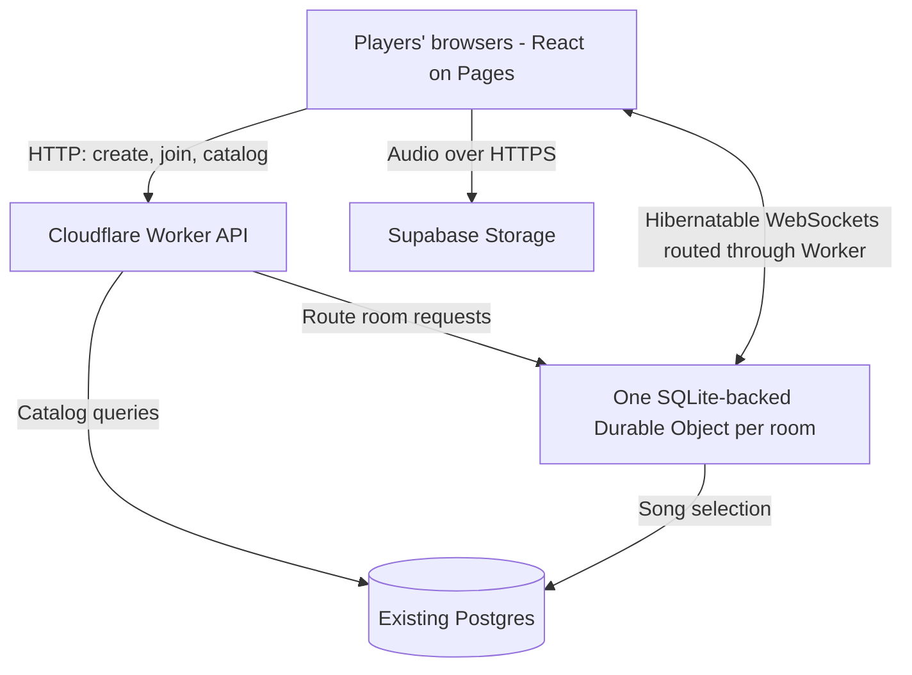

# Animasters multiplayer architecture

Created: October 21, 2026
Updated: October 28, 2026
Status: Architecture and core gameplay accepted, including SQLite-backed Durable Objects, WebSocket hibernation, and Manami's snapshot with our own season mappings. Technology modernization is complete. All seven reviewed MVP defaults were accepted on October 24. The initial catalog and season mappings are implemented and imported into Neon; browser autocomplete and versioned export are implemented; the multiplayer lobby is deployed; readiness, scheduled playback, guessing, scoring and automatic progression are implemented locally.
Scope: The `animasters` frontend and `match-generator` backend.

## Product direction

Animasters will become a browser-based multiplayer anime-song guessing game. Players join a shared room from their own devices, listen to the same song on their own devices, select an anime through autocomplete, and submit a final guess or pass. The backend validates answers, awards points according to the order of correct guesses, reveals round results, and coordinates progression through the match.

The room creator is the host. Everyone connected clicks Ready to start automatically; the host can edit match preferences in the lobby before becoming ready. Hosting does not require their browser to run the game server. The backend owns the game and can continue if the host disconnects.

Terminology for the new game:

- **Room:** The shared space containing players, settings, and a game session.
- **Match:** A sequence of song rounds ending with final standings.
- **Round:** One song, a guessing period, and its results.
- **Ready:** A player's explicit confirmation that they can start or continue. This is distinct from finishing a guess and from the browser reporting that audio has loaded.

## Accepted decisions

| Area | Decision | Reason |
| --- | --- | --- |
| Client | Keep the React webapp on Cloudflare Pages. | Players can join through a browser without installing anything. |
| API | Keep and extend the Cloudflare Workers backend in `match-generator`. | Reuse the existing API and song-selection logic. |
| Multiplayer | Use one SQLite-backed Cloudflare Durable Object per room, with WebSocket connections from players. | Give each room one authority and durable storage for shared state and game rules. |
| Room storage | Persist active room and match state in the room object's embedded SQLite storage. | Recover after hibernation or restart without moving the catalog out of Postgres. |
| Connections | Use the WebSocket Hibernation API. | Keep players connected while an idle room sleeps, avoiding idle duration charges when eligible. |
| Scheduling | Persist deadlines, use Durable Object alarms for transitions, and render countdowns locally. | Avoid per-second server ticks and long-lived JavaScript timers that prevent hibernation. |
| Host | A player creates and manages the room; the server runs it. | The match does not depend on the host's browser staying open. |
| Catalog database | Keep the existing Neon Postgres database, originally described as deployed through Vercel. | Preserve song metadata and support catalog search and saved results. |
| Audio storage | Use Supabase Storage. | Firebase has already been replaced; the owner reports Supabase playback is working. |
| Playback | Schedule the same initial playback start on every device; afterward each player may stop, pause, rewind, and replay independently. | Coordinate the beginning of the round without continuously synchronizing players' audio positions. Local controls never change the guessing deadline. |
| Audio enablement | Use an explicit “Enable audio and join” interaction in the lobby. | Initialize/resume browser audio during a genuine user gesture; refreshes or browser suspension may still require another interaction. |
| Media preloading | Preload the upcoming song during the intermission. Do not extend the 10-second wait for a device still loading. | Slow-load recovery and room-wide failed-song replacement are outside the MVP. |
| Answers | Autocomplete resolves titles and aliases from a broader TV/web-series answer catalog to canonical IDs, including anime with no songs in our playable catalog. | Players may submit valid anime choices that are wrong for this round; catalog membership must not reveal song availability. |
| Local autocomplete | Prefer a downloaded, cached local answer catalog; measure the full catalog before selecting the final index implementation. Each canonical anime has multiple aliases and a stable ID referenced by songs through a foreign key. | Keep typing responsive while preserving exact server-side answer validation. |
| Catalog source and mappings | Use Manami's `2026-27` snapshot for the MVP and maintain our own season-to-answer mappings, stable IDs, aliases and later additions. | Start with broad title coverage while preserving our gameplay distinction between regular seasons and major sequels. Source selection is settled; the archived project is not an ongoing update feed. |
| Scoring | Correct guesses earn N, N − 1, and so on in server acceptance order; incorrect guesses earn −1; passes earn 0. | Reward earlier correct guesses. This replaces the original elapsed-time scoring proposal. |
| Timing | Maximum 90 seconds of guessing; the first submitted guess starts a 20-second window capped by that maximum. | Allow recognition time while bounding each round. A pass does not start this window. |
| Reveal | Reveal when everyone has guessed or passed, or the deadline expires. | Keep the answer private while anyone can still submit. |
| Between rounds | Start the next round after 10 seconds or when all connected players hit Ready, whichever comes first. Only disconnected players are excluded from readiness checks. | Connected players are not made to sit out because they did not click Ready. The proposed 60-second wait/skip rule is superseded. |
| Completed-room retention | Expire the room 30 minutes after match completion. | Keep results available briefly without retaining rooms for 24 hours. Unfinished rooms expire after 30 minutes with nobody connected. |
| Roster | Initially at most 10 players; no new players after the match starts. | Bound initial scope. Existing players may reconnect throughout the match. |
| Host departure | No host transfer in the first iteration. | Started matches advance automatically; the original host retains their identity on reconnect. |
| Disconnects | Preserve the player's slot and score for the whole match; skip them for readiness and award 0 for unanswered rounds. | Continue play without excluding a returning player permanently. |
| Ties | Allow shared final positions in the first iteration. | A first-correct-guess flash tiebreaker is deferred. |
| Statistics | Defer retained per-player scores and song counts to the second iteration. | Keep the first version focused on playing and completing matches. |
| Recovery | Persist room state and support player reconnection. | Refreshes, brief disconnects, and object restarts should not erase the match. |
| Information disclosure | Keep selected answers and future rounds on the server until permitted. | Avoid exposing the entire answer sheet through the browser's network responses. |

The Supabase change concerns audio storage. It does not imply a migration of the existing Postgres database, adoption of Supabase Auth, or use of Supabase Realtime for room coordination.

SQLite here is embedded in each Durable Object. It is not another separately hosted database, Cloudflare D1, or a replacement for Postgres. Supabase continues to deliver audio directly to each device.

## Completed technology foundation

- Frontend: Vite, React Router 6, React 19, MUI and Emotion; existing local-player UI and behavior retained. React/MUI upgrade committed as `62afd03`; the owner confirmed the frontend deployment works.
- Backend: Hono on Cloudflare Workers, Wrangler 4, TypeScript, ESLint, generated Worker runtime types, and 30 regression tests. The modernization was committed and pushed as `ae06b23`, preserving the existing HTTP API and song-selection behavior. Deployment testing is separate from this architecture decision.
- Existing Postgres connection and driver remain in place. The frontend retains Yarn; the backend retains npm and its lockfile.

The framework choice is settled. The initial catalog import and explicit season mappings are implemented in `match-generator`; room creation, joining and lobby reconnection are deployed; the gameplay protocol is implemented locally. Historical findings remain in [Technology review](technology-review.md).

## System responsibilities



### Frontend

The frontend renders the lobby, audio player, guess input, countdown, round results, and final standings. Zustand can continue to hold the server's latest room snapshot and local UI state.

Clients send intentions, such as starting a match, submitting an anime ID, or becoming ready. They do not authoritatively advance rounds, judge answers, or modify scores. Volume and local audio controls remain device-specific; local playback problems do not change the server's clock.

### Worker API

The Worker handles entry points for room creation, joining, catalog delivery or search, and WebSocket upgrades routed to the correct room. It validates inputs and room access. Backend credentials remain on the server.

The existing song-generation code becomes an internal service used when preparing a match. Multiplayer clients no longer call an endpoint that returns the complete selected song list and answers.

### Room Durable Object

Each room owns its roster, host identity, settings, selected songs, current phase, deadlines, submissions, readiness, and scores. All authoritative changes pass through that object.

Persist the state needed to recover a match in the object's SQLite-backed storage: roster, host and player identities, settings, private song sequence, phase, readiness, deadlines, accepted submissions, scoring order, scores, and processed action identifiers. Acknowledge accepted state-changing actions only after their durable update succeeds, so a reconnect cannot lose an acknowledged guess. In-memory state alone is insufficient because hibernation resets it.

Accept sockets through the WebSocket Hibernation API. Restore room state after wake-up and associate surviving sockets with authenticated player IDs using connection attachments. Attachments identify connections; durable room storage remains authoritative for gameplay. Hibernation is not a player disconnect and must not change readiness, roster membership, or scores.

Use alarms for scheduled phase transitions, with handlers safe to retry. Always check stored deadlines when processing incoming actions: a delayed alarm must not permit a late guess. Browsers render their countdowns locally from server timestamps; the server does not need to broadcast a tick every second.

Use the object's alarm to wake at the next necessary transition, then reschedule or clear it as state changes. The first accepted guess may shorten that alarm's deadline. Do not hold a request open or use `setTimeout`/`setInterval` to wait through a listening period. If application heartbeats are needed, use hibernation-compatible automatic replies where possible. Persist changes at gameplay boundaries rather than writing a countdown every second.

### Cost and retention implications

SQLite-backed Durable Objects are eligible for the Workers Free plan. This is an available starting option, not confirmation of the account's current plan or a promise that arbitrary traffic will be free. On the Free plan, operations exceeding an allowance fail instead of generating automatic overage charges. Verify the account plan and current limits before multiplayer deployment. [Cloudflare pricing](https://developers.cloudflare.com/durable-objects/platform/pricing/)

Hibernation avoids eligible idle duration usage; requests, active duration, storage operations, and retained data still count toward their respective allowances. The Worker API, catalog database, and audio storage have their own usage. One room object serves all of its players; audio bandwidth never flows through it. Measure representative matches before estimating capacity.

Expire completed rooms 30 minutes after match completion. Expire unfinished rooms after 30 minutes continuously without connected players; a return before expiry resets that abandonment window. Hibernation by itself does not delete stored data. Room retention in v1 supports active-game recovery and temporary final standings; it is not the deferred long-term statistics feature.

### Postgres

Postgres owns the persistent anime catalog, aliases, and song metadata. It does not coordinate every live gameplay event. Retained match statistics are deferred to the second iteration; the first iteration still persists active room state and displays final standings from that state.

Manami's `picture` and `thumbnail` URL fields are now imported into Neon along with the source release identity. Retain release-level artwork references so merging seasons into one accepted-answer group does not discard the original season artwork. A canonical answer can have a chosen representative image. This stores URL strings, not image files. Keep these fields out of the local autocomplete payload initially; fetch only the artwork needed for visible UI and use a placeholder on failure. Do not send or preload the current song's answer artwork before reveal. The exact image presentation is a UI detail, not a new MVP dependency. The initial import was applied on October 24, after validation on an isolated Neon branch. Image binaries were not downloaded or mirrored.

Future statistics should include each player's final score and number of songs played. Before implementation, define stable identity across matches and what counts as a played song, especially during disconnects. Nicknames alone cannot identify a person reliably. Future result writes should be retryable without duplicates and should not block showing final standings.

### Supabase Storage

Supabase serves audio over HTTPS directly to players. WebSockets carry game messages, not audio bytes. Store a media reference on each song and resolve it into a playable URL on the backend, keeping storage-specific URL construction out of game UI components.

Keep public Supabase asset URLs for the MVP. Before multiplayer, migrate playable assets to opaque paths and strip answer-revealing metadata. Private signed delivery can be considered later; it is not part of the accepted MVP.

Use opaque object names and remove embedded titles or artwork that reveal answers. A signed URL still exposes its object path, so signing a descriptive filename does not hide the answer. Audio already delivered to a browser can be inspected or replayed; this design prevents easy metadata leakage, not all cheating.

## Room and round lifecycle

```text
Lobby -> Load audio + Ready -> Scheduled start -> Guessing (maximum 90s)
                                                     |
                        First guess -> Remaining time capped at 20s
                                                     |
                     All finished or deadline -> Reveal + round results
                                                     |
             Next round: 10s or all connected Ready / Final standings
```

1. The host creates a room and chooses match settings.
2. Players join through a shareable link or short room code, choose nicknames, and use “Enable audio and join.” Initialize/resume the audio context directly in that gesture, before awaiting network work. Start loading the answer index in the lobby.
3. The backend assigns each player an identity and a private reconnect token. A nickname or room code is not proof of ownership of an existing player.
4. Each connected player loads the pinned search index and clicks Enable audio & Ready. Once all connected players are ready, the room starts preparation automatically. The server fixes the roster, selects and retains the song sequence, and refuses new joins. Authenticated reconnections are not new joins.
5. For the first round, the server distributes permitted media information and starts a full 10-second preload countdown. Lobby Ready clicks cannot shorten this first countdown. There is no additional audio-loaded wait. Disconnected players do not block readiness.
6. The server publishes a shared start time. Guessing opens at that time, with no minimum listening period. The initial deadline is 90 seconds after the start. For subsequent rounds, start after the 10-second intermission or earlier once every connected player hits Ready; missing a Ready click does not exclude a connected player.
7. A player submits one final guess or passes. An accepted submission cannot be edited or replaced. The server checks identity, round, phase, and deadline; malformed or unauthorized requests are rejected rather than counted as wrong guesses.
8. The first accepted guess, whether correct or incorrect, sets the deadline to the earlier of the original 90-second deadline and 20 seconds after its acceptance. Later guesses do not restart the timer. Passing does not start it.
9. Guessing ends when all players have submitted or passed, or time expires. Unanswered players receive 0 points. A disconnected player with no submission retains the chance to reconnect and answer until the round closes; their absence can therefore leave the round running until its deadline.
10. Reveal the answer, submitted guesses, correctness, score changes, and standings together. Before reveal, acknowledge submission without disclosing correctness or updated scores; player completion status may be public.
11. After reveal, show results and prepare the next round. Connected players can click Ready to shorten the 10-second intermission. At its deadline, the next round starts even if some have not clicked; only disconnected players are excluded from readiness checks. Progression is automatic and does not require the host. After the last round, show final standings, including shared positions for ties, and expire the completed room 30 minutes later.

Treat explicit Ready, browser audio permission, and audio-loaded status as separate signals. For later rounds, Ready means “shorten the intermission”; the 10-second deadline does not require every device to report Ready or loaded. A connected player's slow loading or missed click does not automatically submit a pass or exclude them. A programmatic Ready click cannot substitute for the genuine user gesture that a browser may require to enable audio.

### Accepted countdown enforcement

The Durable Object enforces the 10-second/all-connected-Ready countdown:

- Start of the countdown: the authoritative reveal/results transition, with `nextRoundStartsAt = revealedAt + 10 seconds`. Preload only the next round's now-permitted media during that intermission, not the entire match.
- Persist that timestamp and schedule an alarm. Send the timestamp to clients so they render the countdown locally. An alarm may run late; an incoming action must also check the stored deadline and perform any due transition exactly once.
- An explicit Ready message can bring the shared start forward when every currently connected player is ready. Reconnection during the intermission must not extend its original deadline.
- At the deadline, proceed with all connected players whether or not they clicked Ready. Do not invent player Ready messages or wait for clients to send automatic ones.
- If everyone disconnects, pause between rounds rather than treating an empty set as “all ready.” Begin a fresh 10-second intermission when a player returns before room expiry.

Client-triggered auto-Ready is unsuitable as the sole timer authority: background/suspended tabs can delay JavaScript timers, a disconnected client cannot send its message, and a modified client can withhold it. The frontend countdown is presentation; server deadlines govern progress. [Browser timer throttling](https://developer.mozilla.org/en-US/docs/Web/API/Page_Visibility_API)

“Enable audio and join” enables audio in the lobby; it does not prove that the first song is loaded. The accepted first-round preload countdown handles song loading without an extra wait; a countdown cannot grant audio permission. [Browser autoplay restrictions](https://developer.mozilla.org/en-US/docs/Web/Media/Guides/Autoplay)

Updated first-round flow, accepted October 27: everyone connected enables audio, loads the pinned search index and clicks Ready; the room starts automatically. After generating the match, preload the first song for a full ten seconds without an additional audio-loaded wait. Later rounds retain ten-seconds-or-all-Ready behavior. This supersedes the October 24 host-start/first-round-Ready shortcut.

The “one final guess” interpretation follows the requested submit-or-pass flow. Correct guesses are ranked among correct guesses: wrong answers and passes do not consume a positive scoring position. These interpretations are made explicit in the scoring example below.

### Deadline examples

- First guess at 12 seconds: the round ends by 32 seconds.
- First guess at 85 seconds: the round still ends by 90 seconds.
- Nobody guesses: the round ends at 90 seconds, or sooner if everyone passes.
- Everyone finishes before the deadline: reveal immediately.

The persisted deadline is `min(roundStartedAt + 90 seconds, firstGuessAcceptedAt + 20 seconds)` once a first guess exists. Before then, it is `roundStartedAt + 90 seconds`.

## Playback and timing on separate devices

Each device fetches the same audio segment and initially plays it from the same offset at a server-defined start time. After that initial start, playback is independent: players can stop, pause, rewind, and replay without changing anyone else's audio or the shared guessing deadline. Do not periodically seek players back to a shared position. The earlier recovery proposal requiring catch-up to a shared position is superseded.

Recommended scheduling mechanism:

1. “Enable audio and join” initializes/resumes a reusable audio context during the user's click. Keep that context across round changes; handle suspension with an explicit resume control when necessary.
2. During the intermission, fetch and prepare the upcoming audio. The player controls remain attached to the current/revealed round until the next scheduled start. Preloading must not automatically play the upcoming track.
3. Estimate server-clock offset with several short timestamp exchanges, using lower-round-trip samples to reduce error. Use a monotonic local clock for scheduling; a device's wall clock may be wrong.
4. Publish a future `startsAt` timestamp, rather than asking clients to play as soon as a WebSocket message arrives. The ordinary intermission already provides advance notice. If everyone becomes Ready early, announce a revised start with a small delivery margin (for example 500 ms, to tune), capped by the original 10-second deadline. This is an implementation proposal; it cannot guarantee delivery before the start on every connection.
5. Map that timestamp to the browser audio clock and schedule the prepared audio. Web Audio's `AudioBufferSourceNode.start(when, offset)` supports scheduling decoded audio; evaluate this approach on the target phones. Guessing opens at the same authoritative timestamp, regardless of an alarm's delivery time.
6. After the initial start, manage playback offsets locally. With decoded buffers, pause/rewind/replay create replacement source nodes using the same buffer and the chosen offset. Cancel stale scheduled sources when a round changes or an earlier start replaces the original schedule. Keep only the current and upcoming audio buffers to bound memory.

Repeat the scheduled-start procedure for every song. Estimate clock offset when joining, refresh it after reconnect/background suspension and periodically if needed; do not reset a player's chosen playback position during an active round. Bluetooth is not an application component or integration: it was only an example of output delay when a player chooses wireless headphones. No Bluetooth-specific compensation is planned for the MVP.

This aims for closely aligned starts on healthy, foreground devices, not sample-perfect synchronization across browsers, speakers, or Bluetooth outputs. It does not compensate for network/device latency in scoring. [Scheduled Web Audio playback](https://developer.mozilla.org/en-US/docs/Web/API/AudioBufferSourceNode/start)

Accepted MVP recovery policy:

| Situation | Recommended behavior |
| --- | --- |
| Connected device is still loading when a later round starts | The shared round and deadline proceed. Keep the player eligible to guess or pass. No special waiting, compensation, or slow-load recovery mechanism in the MVP. Do not mark them skipped for missing Ready. |
| Browser blocks playback | Show an explicit “Enable audio / Resume” control and handle playback/context-resume failures. Resuming does not restart the round clock or impose continuous position synchronization. |
| Network disconnect during guessing | Preserve the player's accepted submission and score. Reconnect returns the current server snapshot and still-open deadline; a player who has not submitted can still guess or pass. If the same round is still active and the browser player survived, preserve its local playback position and paused state. |
| Reconnect after a guess was sent but its acknowledgement was lost | Recover the accepted submission from the server or retry the same action ID. Never grant a second attempt or award points twice. |
| Reconnect after reveal or after the next round begins | Show the actual current phase. Do not replay a missed round as a fresh scoring opportunity. |
| Media remains unavailable on one device | Allow pass; unanswered rounds remain 0. Do not automatically mark the player wrong or restart the round for everyone. Additional media-recovery UX is deferred. |
| Media is unusable for the entire room | Defer voiding/replacement, host skip, and failure-voting mechanisms beyond the MVP. The normal guess/pass/deadline rules still apply. |

A full page refresh loses in-memory playback state. After restoring room state and enabling audio again, let the player restart the current clip locally if the round is still open. This grants no extra guessing time or additional submission. Manual replay is already allowed, so reconstructing the exact previous audio position is unnecessary. Play each existing file from its beginning, allow manual replay, and disable automatic looping.

The room assigns an authoritative sequence to accepted guesses before unrelated asynchronous work and commits submissions and scores without race conditions. This sequence determines correct-answer rank, even when two submissions have the same millisecond timestamp. Server time determines deadlines, not the number of points. Do not trust client-reported timing or rank. Network latency and device playback latency will still introduce some variation. The accepted target is a casual multiplayer game, not a claim of perfectly synchronized competitive timing.

Preloading also lets a determined client inspect audio before the scheduled start. Stronger protection would require a separate design tradeoff; opaque references and server-controlled scoring are the initial approach.

## Search and answer identity

Separate anime identity from the display strings currently stored on songs:

| Concept | Information |
| --- | --- |
| Anime | `anime.id`: stable canonical answer ID, plus a preferred display title. |
| Anime alias | Many alternate titles or abbreviations per anime; `anime_alias.anime_id` references `anime.id`. An alias row may have its own ID for management, but guesses use the anime ID. |
| Song | Existing metadata and media reference; `catalog.song_anime` links the song ID to `catalog.anime.id` with foreign keys while preserving the legacy API. |

For example, “Attack on Titan” and “Shingeki no Kyojin” can resolve to the same ID. Search may tolerate spelling differences, but submitting a selected result produces an exact ID for server validation. Curated aliases are preferable to guessing whether arbitrary free text should count as correct.

The backend currently selects distinct `songs.anime` text values; it has not yet been migrated to this identity model. The initial additive migration uses `catalog.song_anime`: its `song_id` references `public.songs.id`, and its `anime_id` references `catalog.anime.id`. This preserves the deployed `SELECT * FROM songs` response shape while adding an authoritative foreign-key relationship. Review existing titles against the catalog and retain legacy display metadata. A direct column on `songs` can be considered after explicitly versioning the API; it is unnecessary for the initial import. Use internal IDs that survive display-title edits or provider changes. The room stores the selected song's accepted canonical ID privately and compares it with the submitted anime ID; the browser receives neither song-to-anime mappings nor the answer before reveal. Do not require an anime to have a song.

Multiple aliases should return one canonical result. The same alias text can legitimately match multiple anime: do not force it to be globally unique or silently choose one. Show distinguishable canonical choices. External provider records and IDs need a mapping to our answer groups because regular seasons can share an answer while major sequels remain separate.

The earlier estimate was 143 songs. A read of the deployed Neon database on October 24 found 125 songs across 67 distinct anime labels; the initial backfill targets those observed rows. Song count is not autocomplete size: autocomplete contains distinct anime answer identities and aliases, not audio files or a row per song.

The answer catalog is independent of the playable song catalog. An eligible TV or web series may have zero songs and must still be searchable and selectable. Its valid ID is accepted as a guess and scores −1 when incorrect; it is not rejected merely for lacking songs. Do not filter search by song availability, current settings, or the selected match, and do not show an “available songs” badge. The older playable-catalog-only recommendation is superseded.

Accepted October 25: the searchable catalog includes **TV releases and ONA (web) releases with more than one known episode in one pool**. Exclude answers whose releases are only MOVIE, OVA, SPECIAL or UNKNOWN. Eligibility comes from all releases in the canonical group, not only its artwork representative. Format is not an identity rule: explicit season/duplicate mappings still control which releases share an answer. Filtering happens in the export, so excluded records are not downloaded. Source format and episode count form the MVP eligibility rule; editorial review can address misclassification. All 125 current songs have an eligible answer.

ONA releases with one episode or an unknown count are excluded. TV releases remain eligible regardless of count. Manami can classify multi-part movies as ONA with multiple episodes, so editorial exceptions may still be needed; this rule does not claim complete classification. Episode counts are stored per release through additive migration `003_release_episodes.sql`, backfilled from the pinned snapshot, and retained on future imports.

Accepted October 25: target English, Spanish and Japanese aliases, including romaji. Remove confidently identified other-language aliases but retain uncertain spellings. Language tags from the pinned AniDB title dump supplement Manami’s unlabelled synonyms; Latin-script removals require a second pinned language check to avoid deleting supported wording tagged as another localization. Originals are archived in `catalog.excluded_aliases` and suppressed on repeat imports. This is administrative curation, with no per-player upstream language lookup. See `match-generator/catalog/alias-language-cleanup.md` for audit criteria and savings.

Accepted October 26: remove capitalization-only aliases within each anime and deduplicate exported aliases against the display title. Preserve the original first indexed spelling and every canonical ID. Full before/after index comparison verified unchanged search data and ordering. Accent, punctuation and whitespace differences are outside this cleanup. See `match-generator/catalog/alias-capitalization-cleanup.md`.

Local search is the preferred direction, subject to measuring the full answer catalog. Download/cache a compact, versioned catalog in the lobby, index it in a Web Worker, and search locally so each keystroke does not wait for a round trip. The index contains canonical answer IDs, display titles, aliases, a popularity/editorial weight, and release type/year for disambiguation; no song-to-media mappings or selected-round information. Postgres remains the catalog source of truth. Publish the export once per catalog version as a cacheable asset, rather than querying/exporting the database for each joining player. Asset hosting can use Pages or a cacheable Worker endpoint; a separate search service is unnecessary for the initial design.

The initial implementation uses a small custom index in a dedicated browser Web Worker: sorted normalized aliases with prefix lookup plus a corpus scan for internal/reordered matches. It has no search-library dependency. Measure compressed payload, indexing time, memory use, and input-to-results latency on phones with the intended full catalog. Proposed warm-search target: results within 50 ms on representative devices. If downloading/indexing the full catalog is too expensive, compare partitioned indexes or cached server search. A server fallback is optional scope, not a requirement for MVP, and must search the same broad catalog if added.

### What downloading and caching in the lobby means

1. Publish a small manifest and a compressed JSON asset with a content version in its URL, such as `/catalog/anime.<hash>.json`. A compact entry contains one canonical ID, one display title, and its aliases. No images, descriptions, audio, or individual alias-row IDs are needed for guessing.
2. On entering the lobby, request the version required for the room. On a first visit or cache miss, download the asset while players join and configure the match; show search-loading progress.
3. Use normal browser HTTP caching initially: revalidate the manifest and give immutable versioned assets a long cache lifetime. On another visit, reuse the same asset when still cached. Cache eviction/private browsing may require a fresh download; do not promise permanent storage. A service worker or IndexedDB is not necessary just to obtain this basic behavior. [HTTP caching](https://developer.mozilla.org/en-US/docs/Web/HTTP/Guides/Caching)
4. Parse/build the searchable index in a Web Worker. Keep it in memory across rounds. Normalize query/title variants for search, rank exact title/alias matches first, then popularity/editorial weight for partial matches, and deduplicate by canonical ID. The UI sends query text to this worker and receives a small result list. This browser worker is distinct from the Cloudflare Worker API.
5. Only the selected canonical ID is submitted over the room connection when the player confirms a guess. Changing aliases in a new catalog release must not change existing anime IDs. Retain compatible catalog versions for active rooms and do not switch indexes mid-match.

Deployment clarification: the browser Web Worker belongs to the `animasters` frontend build and executes on each player's device; it is not a new hosted service. `match-generator` can own the catalog import/export tooling, manifest and versioned asset delivery. Each browser can cache the downloaded asset; each active app instance builds and owns an in-memory search index, normally rebuilt after refresh. Running the search itself in `match-generator` would make it server-side search and reintroduce a network request per query. [Browser Web Workers](https://developer.mozilla.org/en-US/docs/Web/API/Web_Workers_API/Using_web_workers)

Complete initial search-index loading before that connected player can become Ready. This is separate from the subsequent 10-second song-preload countdown. A network failure while fetching the index should show an error/retry path rather than silently limiting search to the playable catalog.

### Catalog sizing before implementation

Do not extrapolate from the 125 currently observed playable songs (earlier estimated as 143). Count canonical anime and aliases after selecting/importing the broader data source. Estimate raw payload as `animeCount × (ID/title/JSON overhead + averageAliases × averageAliasBytes)`, using UTF-8 byte sizes rather than character counts.

Illustrative arithmetic only: assume 100 bytes per anime for ID, display title, and structure, plus five aliases averaging 40 bytes each including structure. That is 300 bytes per anime:

| Canonical anime | Alias strings at five per anime | Uncompressed catalog at 300 bytes/anime |
| --- | --- | --- |
| 10,000 | 50,000 | 3 MB |
| 30,000 | 150,000 | 9 MB |
| 50,000 | 250,000 | 15 MB |

These are scenarios, not actual dataset counts, measured sizes, or upper bounds. Long/multilingual titles, alias counts, and encoding change the result. Measure raw, gzip, and Brotli sizes on the real export; do not assume a compression ratio. Also measure parsed/indexed memory and cold-start indexing time, which are separate from network transfer size. A large fuzzy-search index can cost substantially more memory than its JSON representation. Record phone cold-load and warm-search measurements before committing to a library or splitting the catalog.

Follow-up measurement on October 23, 2026: a title/alias projection of Manami release `2026-27` contains 41,537 source entries and 243,194 alias strings, occupying 10,886,092 raw bytes, 3,041,286 gzip bytes, or 2,487,503 Brotli bytes. This is an ungrouped projection with temporary sizing IDs, not the final canonical answer catalog or a phone-performance benchmark. See [catalog source comparison and measurement method](autocomplete-catalog-research.md). On October 24 the owner accepted this snapshot and our own season mappings. We own subsequent additions and corrections; the archived repository is not an active update feed.

Local Node.js/V8 measurements on October 24 provide an initial memory comparison: parsed catalog alone approximately 38.6 MB; catalog plus a sorted normalized-term array, typed numeric owners and ID map approximately 61.4 MB; catalog plus a naive normalized-name-to-ID-array map approximately 130.2 MB. Adding both image URL strings to every browser record raises the sorted variant to approximately 81.4 MB. These are decimal MB of retained JavaScript heap plus typed-array storage after garbage collection, excluding startup peaks, browser/worker overhead, React and decoded audio. They are not guaranteed browser RAM limits. Prefer a compact representation and keep the catalog in the browser worker only; send a small result list to the UI rather than copying the whole catalog. Use roughly 80 MB as an initial retained-search-memory engineering budget to validate on target browsers, not a measured upper bound. A final fuzzy index may change that budget.

The initial pinned import, attribution/license notices, aliases and explicit mappings for current songs are in place. Continue curating other franchises as needed and preserve manual corrections across later imports. Do not put a third-party catalog API on the per-keystroke gameplay path. Pin a compatible catalog version for a match so cached choices remain valid throughout it. Require selection of a known anime ID. If no result matches, the player can revise the query or pass; arbitrary free-text submissions are outside the MVP.

Regular seasons share an accepted answer identity: a franchise title counts across its seasons. Major sequels can have separate identities: Naruto and Naruto Shippuden must not accept each other's answers. Maintain this as a curated catalog mapping, not a fuzzy-string heuristic. Search should clearly distinguish separate sequel identities. A song retains its specific season metadata for display at reveal while pointing to the canonical identity accepted for guessing.

## Scoring, visibility, and resilience

- For the kth correct guess, award `N − k + 1` points. Incorrect guesses award −1; passes and unanswered rounds award 0. There is no continuous time-based bonus.
- Fix N to the match's starting roster size, including the host if playing. Keep N unchanged across disconnects, since those players retain their slots. Scores may be negative; no zero floor was requested.
- The server retains the accepted submission and awarded score. Retries and duplicate messages must not award points twice.
- Include round identifiers and action identifiers so delayed messages cannot affect a later round and retries can be recognized.
- Broadcast only permitted room information. Keep answers, other players' guess contents, and future songs private until the appropriate reveal phase.
- On reconnect, authenticate the player and send a current snapshot with its phase, deadlines, personal submission status, and permitted scores. Do not rely solely on replaying missed messages.
- Apply host privileges on the server. Do not transfer them. Lobby readiness checks exclude disconnected players, including the host; all remaining connected players being ready can start the match. Once started, game progression does not depend on host actions.
- Initially cap the room at 10 players. Reject new players after match start. Preserve existing players' reconnect identity, slot, score, and submissions throughout the match; reconnecting does not provide another attempt.
- Skip disconnected players when checking readiness. Unanswered rounds score 0; already submitted guesses retain their actual result. All-disconnected rooms must not advance through songs with nobody present; suspend between rounds. An active round can still finish at its existing deadline. Expire the unfinished room after 30 minutes with nobody connected; resume a paused intermission with a fresh 10 seconds when someone returns before expiry.
- Validate message shapes and bound guesses, search requests, and room creation. Reject unauthorized actions regardless of what controls the UI displays.

### Scoring example

In a four-player match, A submits an incorrect answer, B submits the first correct answer, C passes, and D submits the second correct answer. Round points are A: −1, B: +4, C: 0, D: +3. A's guess starts the 20-second timer even though it is wrong. B and D receive no correctness confirmation until the round reveals.

Final standings can contain ties. The proposed flash round, in which the first correct guess wins, is explicitly second-iteration scope; it is not implemented as a hidden tie-breaking rule in the first version.

## Alternatives considered

| Alternative | Decision |
| --- | --- |
| Host browser coordinates peers over WebRTC | Not selected. Adds signaling, connectivity, host departure, and trust concerns without a clear advantage for this game. |
| Dedicated continuously running game server | Viable, but not selected. Adds infrastructure when the existing Cloudflare stack can manage rooms. |
| Postgres as the live room coordinator | Not selected. Keep live coordination in the room object and use Postgres for catalog and retained data. |
| Separate search service | Defer. Prefer a versioned local answer catalog, subject to full-catalog size and phone-performance measurements. |
| Shared-speaker gameplay | Outside the chosen initial experience. Every player listens on their own device. |
| Firebase or a new move to R2 | Superseded by the working Supabase Storage migration. |

## Catalog implementation — October 24

The backend now includes `migrations/001_catalog.sql`, a checksum-pinned administrative importer in `scripts/catalog/`, and explicit mapping inputs in `catalog/season-mappings.json`. The readable mapping review is `match-generator/catalog/season-mappings.md`; operating instructions and the dataset license are beside it. These scripts do not run in the public Worker.

| Imported into live Neon | Count |
| --- | ---: |
| Provider releases | 41,537 |
| Canonical answer identities | 41,451 |
| Answer/alias pairs, including release titles | 284,576 |
| Curated groups covering existing songs | 67 |
| Releases explicitly included in those groups | 153 |
| Songs linked through foreign keys | 125 |

All other source releases retain independent answer IDs. The series-only browser export includes answers with a TV release or multi-episode ONA release, including series with no songs; excluded formats remain stored in Neon. This is initial curation for the current playable catalog, not a claim that every upstream franchise has been reviewed. Related-anime links never trigger automatic merges. Major sequel/remake distinctions remain explicit; adding a new playable title requires a reviewed mapping. Each release retains source URLs and artwork; each answer selects a representative release. The initial song backfill does not infer an exact release for each song.

The importer validates the pinned snapshot, rejects missing or conflicting mappings, and applies schema/data in one transaction. It preserves `public.songs` and the deployed API. Repeat import on the temporary branch preserved record counts and integer IDs; fingerprints confirmed every legacy song field was unchanged. Production validation also confirmed the unchanged six-field song response. Applied inputs are checksum-protected: later curation needs a new reviewed migration that preserves existing identities, not edits to an already applied import.

The live catalog tables and indexes initially occupy about 91.8 MB in Postgres. This is database storage, not the browser download or memory requirement. The earlier memory measurements remain estimates for a prototype ungrouped export; measure the final versioned export and browser index separately. The new frontend catalog page downloads a compact export on demand; the existing manual game does not consume it.

## Browser autocomplete and search quality — October 24

The `/catalog` route, linked from home, exposes the reusable MUI autocomplete while the existing manual game remains intact. `match-generator` generates schema-v4 static assets into the frontend's `public/catalog/`; Pages serves them without per-player database queries. Latest manifests revalidate, hash-named files are immutable, and version-specific manifests allow future rooms to pin a catalog. The worker verifies version, hash, size and counts before using a download. No server search request is made while typing.

One browser worker holds the normalized index for that app instance, across route navigation. React receives only small result lists; the downloaded JSON may be reused from the browser HTTP cache. Refresh rebuilds the in-memory index, and closing the tab releases it. There is no localStorage/IndexedDB database. Failure/retry and stale-query handling are implemented; initial room readiness integration remains future work.

The owner accepted **exact title or alias matches first, then popularity for partial matches**. `catalog.search_metadata` separates sourced normalized popularity from an optional editorial override and display-title corrections. The initial 56 weights are provisional editorial prominence tiers, not ratings or measured audience figures. Unknown titles remain selectable with neutral weight. Never infer rank from song availability. A permitted external popularity source and its normalization/update policy remain open.

Explicit `answer_redirects` preserve old IDs when merging reviewed duplicate records. Exports aggregate their aliases under the retained answer; the `answer_identity` and `song_answers` views provide canonical resolution for future backend use. The initial two reviewed pairs are One Piece TV (1999) and Nanatsu no Taizai OVA (2015); the OVA remains distinct from its TV series in Neon and is excluded from series-only search. Hunter x Hunter adaptations are explicitly labeled, and results show release format/year. Similar titles are not automatically merged. The full catalog still needs further curation; this does not resolve every repeated title.

The October 26 series-only export has 14,872 canonical answers and 87,022 additional aliases: 3,519,584 raw bytes, 1,150,999 gzip bytes, or 878,482 Brotli bytes. Artwork and song mappings remain excluded. These are offline compression measurements; Pages negotiates actual transfer encoding. The Node/Apple Silicon benchmark retained approximately 15.0 MB heap plus 0.68 MB typed-array buffers, built the index in about 204 ms, and measured warm query p95 at 7.4 ms over 170 queries. This excludes startup peak, the 60 ms UI debounce, rendering and message delivery; real-phone latency and memory remain unverified.

Current search supports normalized prefixes, substrings and reordered tokens, with a two-character minimum and twelve-result limit. Edit-distance typo correction is not implemented. The reusable component returns a known ID on selection, but no guess/scoring submission has been added to the old game.

## MVP defaults accepted October 24

All seven defaults below are accepted. Remaining engineering details and data curation do not require reopening these gameplay decisions.

| Area | Accepted default |
| --- | --- |
| Scoring | One final guess or pass. Only correct guesses consume positive ranking positions. N is fixed to the starting roster, including the playing host. Scores may be negative. |
| Countdown and first round | Backend deadlines; intermission begins at reveal. Updated October 27: everyone connected enables audio, loads search and clicks Ready; first song then has a full ten-second preload countdown. |
| Playback and refresh | Existing files play from the beginning, with manual replay and no automatic loop. Socket recovery preserves local playback; full refresh permits restarting the current song with only the remaining guessing time. |
| All disconnected | Finish an active round on its existing deadline, then pause. Resume with a fresh 10-second intermission when someone returns. Unfinished rooms expire after 30 minutes with nobody connected. Completed rooms expire 30 minutes after completion. |
| No autocomplete result | Select a known anime, revise the query, or pass. No arbitrary free-text submissions. |
| Guest identity / tabs | No accounts: nickname plus a private reconnect credential on that browser/device. A new connection for the same identity replaces the old connection. A different device does not automatically inherit that identity. |
| Audio delivery | Public URLs for MVP, opaque filenames and stripped answer-revealing metadata before multiplayer. |

Implementation details we can settle during development without reopening product choices: versioned message schemas, action IDs and deduplication, atomic storage updates, alarm retry handling, reconnect backoff, room-code generation, and input/rate limits. Tests must establish that these mechanisms preserve the accepted rules.

The initial catalog import, editorial metadata layer, static export and browser autocomplete are implemented. Continue explicit duplicate/season curation and measure browser performance on representative phones. Keep provider release records separate from canonical answer groups. A future catalog refresh must not overwrite local aliases/mappings or alter an active match's answer identities.

Deferred to the second iteration: flash tiebreaker, retained per-player scores and song counts, and the identity and retention policy needed for those statistics. Host transfer and late joins are outside the first iteration. Special recovery for songs still loading after the intermission and room-wide failed-song void/replacement mechanisms are also outside the MVP.

## Room creation and lobby — October 27

Accepted: room codes have exactly four characters from `A–Z` and `0–9`, with no special characters. Code input converts lowercase ASCII letters to uppercase, removes other characters, and limits the result to four characters. The API also accepts lowercase and validates the full code. All 36 characters are available; a code need not contain both a letter and a digit.

The deployed first multiplayer slice adds `/rooms` and `/rooms/:code`, while retaining the manual game. Players create a room with a nickname, copy its code or invite link, or join an existing room. Live lobby snapshots show the host and connected players. Editable match settings remain outside this first slice; audio enablement, catalog readiness and gameplay were added in the subsequent implementation below.

The Worker reserves codes using cryptographic randomness and a collision check inside the room Durable Object. The object name is the code; its SQLite record owns the roster and host identity. A collision retries another code rather than replacing an existing room. Nicknames are trimmed, normalized to NFC, limited to 24 Unicode code points, and unique within a room ignoring case. Control/format characters are rejected. The roster limit is ten including the host; disconnected players retain their slots.

A private random credential identifies each player. It is stored in this browser origin's localStorage and is never put in invite links or public snapshots. HTTP session checks use a bearer header; WebSocket handshakes use a credential subprotocol, selecting only the non-secret `animasters` protocol in the response. A new authenticated socket replaces that player's old socket. Refresh restores the same identity. No accounts or cross-device identity transfer are introduced.

Hibernatable sockets broadcast lobby snapshots on membership/connection changes. Automatic ping/pong replies do not require a running per-room timer. The client uses bounded reconnect backoff and checks saved membership before connecting so expired rooms have an actionable error. Rooms with nobody connected expire after thirty minutes, including newly created rooms whose creator never connects. Alarms and request-time checks enforce expiry; an expired code may be reused with new credentials. Lobby storage does not query Neon or change existing song data.

Development uses `VITE_API_URL` to target a local Worker. Wrangler includes the `ROOMS` binding and the append-only `v1-rooms` SQLite-class migration for the existing deployment target. The multiplayer game must still implement the accepted readiness, timing, scoring, media privacy and catalog-version rules; lobby connection does not mean a device is ready to play.

## Playable match flow — October 27

Implemented locally after the owner confirmed the room deployment. Every connected player explicitly clicks **Enable audio & Ready** after the room's catalog is indexed. The browser resumes its reusable AudioContext in that click; the room verifies readiness against its pinned catalog version. There is no separate host Start. Readiness on a replacement lobby connection resets because a refreshed browser may need to enable audio again.

Defaults are persisted per room: 40 songs, openings/endings/soundtracks enabled, no repeated canonical anime. Multiplayer uses one read-only Neon query joined to `catalog.song_answers`, groups eligible songs by canonical ID and samples without replacement. The legacy generation endpoint remains unchanged. The database's song-type enum is compared as text against bound filter values. Insufficient eligible answers return the room to a retryable lobby rather than silently reducing the requested count.

The room persists a preparation attempt ID and timeout before waiting on database work. Only the matching attempt may install the generated song sequence. The roster locks during preparation; late joins are rejected. Preparation failure clears readiness and returns to the lobby. Generated songs and accepted answer IDs remain in SQLite and survive reconnection/hibernation.

The first song gets a full ten-second countdown after generation. The browser preloads and decodes it, estimates server-clock offset using timestamp exchanges and schedules Web Audio playback for the shared start. Guessing opens at that same timestamp. Later rounds preload during the ten-second results interval; all connected Ready clicks can bring that start forward with a 500 ms delivery margin. Local pause/seek/replay do not change the server deadline. Snapshot updates do not restart local playback. Refresh allows enabling audio and restarting the still-open current song, without extra guessing time.

The reusable autocomplete submits a known anime ID only after explicit Submit guess; Pass submits null. Versioned messages carry round/action IDs. Only one answer per player is accepted, and retries cannot double-score. Server acceptance order determines positive scores. Pending correctness, deltas and other players' choices are absent from snapshots until reveal. The 90-second cap, first-guess 20-second window, all-finished reveal, automatic progression, all-disconnected pause and final standings are implemented. SQLite updates precede snapshots; one alarm covers preparation, round deadlines and room expiration, and incoming events also enforce due transitions.

The backend bundles an immutable ID/title projection of the published catalog to validate guesses without a database/network lookup per submission. `scripts/catalog/game-catalog.mjs` verifies the export hash and emits the revision-specific file. The frontend uses that revision in a room-owned browser search worker. Retain published frontend assets and backend answer projections; adding another supported revision requires explicit version dispatch before changing the active default. Do not overwrite an existing projection or change an active room's rules during a deployment.

Validation includes a two-browser local match using the actual Neon catalog and Supabase audio: shared countdown/playback positions, autocomplete submission, the shortened deadline, pass, reveal and preloading the next song. Unit/runtime tests cover state transitions, replayed submissions, scoring, privacy boundaries, preparation, expiry/hibernation and Web Audio scheduling. Exact acoustic skew on different physical phones is not yet measured.

**Remaining media privacy work:** existing Supabase paths contain anime/song names, and audio metadata has not been sanitized. The new snapshots hide the answer fields and future song list, but the current playable URL can still reveal the answer in developer tools. Opaque filenames and metadata cleanup remain required for the previously agreed privacy goal. No remote audio or database records were changed by this implementation.

## Lobby match preferences — October 28

Implemented the same preferences as the manual settings screen: song count, openings, endings and soundtracks. The host edits a local draft and saves it to the room. Guests see the saved values. The room validates host identity, lobby phase, a whole-number count from 1 to 999 and boolean type flags. No types checked retains the legacy meaning of all types. Repeated anime remain disabled; no extra repeat-anime toggle was introduced.

The room persists a settings revision alongside the preferences. Saving a changed configuration increments the revision and clears every player's Ready flag. Lobby Ready carries the revision the player saw, so a delayed click cannot start a match with newly changed settings. Retrying an identical save does not clear readiness again. A host already marked Ready can choose Not ready to edit; settings cannot change after preparation starts.

Match generation receives the saved count and filters. An insufficient filtered catalog returns a specific availability message and resets the room to the lobby; the host can reduce the count or broaden the types. Unknown database errors retain the generic preparation error. No database schema or remote data changes are involved.

## Same-room rematches — October 28

After final standings, players can choose **Ready for next match**. The host can edit the same preferences for the upcoming match; guests see the saved configuration. Saving a changed configuration clears everyone's readiness. All connected players must explicitly opt in again, and reconnecting clears that player's readiness. Disconnected players keep their slots without blocking the next match. The roster, room code, host, pinned catalog and credentials remain unchanged; new joins are still disabled after the initial lobby.

The server accepts a separate `ready-next-match` action with the final result's round ID, catalog version and settings revision. This prevents delayed round Ready messages and readiness left in older deployed rooms from starting another match. Preparation remains serialized and guarded by its generation ID.

Final scores and the last reveal remain visible until song generation succeeds. Success resets scores, submissions, the reveal and the old completion timestamp, then begins a full ten-second first-song preload. A generation error or timeout returns to the final standings with readiness cleared and settings editable. The previous completion expiry is suspended during preparation; failure preserves the original expiry, while successful rematches receive a new thirty-minute retention window when they finish. Long-term match history remains deferred.

## Suggested implementation sequence

Completed work is identified below; the remaining steps describe the delivery order.

1. Technology refresh and MVP product choices complete. Record the agreed v1 API/message contract.
2. Initial catalog import complete: stable IDs, aliases, explicit mappings for current songs, and release picture/thumbnail URLs are in Neon. Versioned export and browser autocomplete are implemented. Continue catalog curation, real-phone measurements, and preparation of media references and metadata for answer privacy.
3. Room creation, joining, SQLite-backed storage, hibernatable WebSockets and reconnection are deployed. Host-editable match settings are implemented locally.
4. Round state machine, audio enablement, first ten-second countdown, later all-ready intermissions and guess deadlines are implemented locally.
5. Autocomplete submissions, scoring, reveal and next-round readiness are implemented locally.
6. Final standings and reconnection recovery are implemented locally. Validate deployment and real-phone audio timing next. Defer long-term statistics and special media-failure recovery.

Validate with multiple real browsers and phones. Cover simultaneous guesses, duplicate submissions, the four-player scoring example, incorrect-first guesses, all-pass rounds, no-guess timeouts, the 90-second cap, deadline boundaries, refreshes, host departure, and object restart or hibernation. Verify shared initial playback, independent controls, and that loading/failed media does not block the server deadline; do not add deferred media-recovery features for these checks. Specifically test wake-up after readiness/submission, deadline enforcement while asleep, retried alarms, socket identity restoration, all-disconnected pauses, the 10-second/all-ready race, connected players missing Ready, and 30-minute completed-room cleanup. Test guessing anime with no songs, alias deduplication/ambiguity, cached catalog versions, and autocomplete performance/coverage on phones. Confirm that pre-reveal responses do not contain correctness, score changes, answers, or the future song sequence. Measure request, duration, and storage usage during representative matches and idle connected rooms.

## References

- [Cloudflare Durable Objects and WebSockets](https://developers.cloudflare.com/durable-objects/best-practices/websockets/)
- [Durable Object alarms](https://developers.cloudflare.com/durable-objects/api/alarms/)
- [Durable Object pricing](https://developers.cloudflare.com/durable-objects/platform/pricing/)
- [Supabase Storage asset delivery](https://supabase.com/docs/guides/storage/serving/downloads)
- [PostgreSQL trigram search](https://www.postgresql.org/docs/current/pgtrgm.html)
- [Browser autoplay guidance](https://developer.mozilla.org/en-US/docs/Web/Media/Guides/Autoplay)
- [WebRTC signaling](https://developer.mozilla.org/en-US/docs/Web/API/WebRTC_API/Signaling_and_video_calling)

This document records the architecture discussion and the owner's confirmation that Supabase Storage replaced Firebase and is working. It does not certify the deployed infrastructure or its current configuration.
